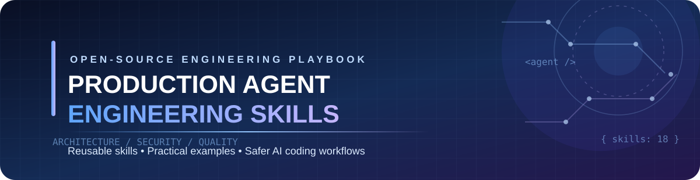
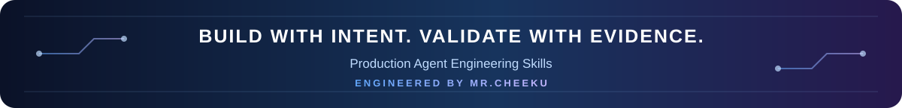

  
  
  
  
  

<strong>Design better systems • Build safer agents • Ship maintainable software</strong>

---

## 🧠 What is Production Agent Engineering Skills?

**Production Agent Engineering Skills** is an open-source engineering playbook for modern AI coding agents and the developers who guide them.

It provides reusable, structured **SKILL.md** guides, practical project templates, reference implementations, validation tools, and GitHub Actions workflows. The goal is to help coding agents move beyond generating isolated snippets and follow disciplined engineering workflows: understand the codebase, choose an architecture, implement carefully, test behavior, respect security boundaries, and document what they actually changed.

This is an independently developed project created and maintained under the **Mr.Cheeku** personal developer brand. Its engineering skills, implementation examples, project templates, documentation, and visual identity are developed as part of this project.

### ✨ Highlights

| Capability | What it does |
|---|---|
| **18 Engineering Skills** | Covers software architecture, Python, AI applications, MCP, APIs, frontend, databases, security, testing, DevOps, and more. |
| **AI Application Engineering** | Guides provider integrations, structured outputs, streaming, evaluation, cost control, and failure handling. |
| **MCP & Agent Tools** | Explains scoped MCP tools, typed inputs, permission checks, bounded agent loops, and user approval. |
| **Automation Engineering** | Demonstrates allowlisted Home Assistant reads and explicitly confirmed light-control actions. |
| **Python & CLI Engineering** | Covers modular Python packages, type hints, packaging, errors, logging, and testable command-line tools. |
| **Frontend & Design Systems** | Includes semantic design tokens, reusable UI patterns, responsive layouts, and theme switching. |
| **Security-First Workflows** | Emphasizes least privilege, secret handling, input validation, privacy, and safe execution. |
| **Validation & CI** | Includes skill validators, Markdown link checks, tests, linting, and GitHub Actions workflows. |
| **Reusable Templates** | Provides starting points for Python, FastAPI, MCP, AI-agent, and frontend projects. |

> **Important:** Skills are engineering instructions, not permission grants. An AI agent must not be given unrestricted shell, file, network, device, or account access just because a skill describes an integration.

---

## ✨ Core Experience

~~~text
UNDERSTAND TASK → SELECT SKILLS → DESIGN → IMPLEMENT → TEST → REVIEW → SHIP
~~~

The repository is designed around a repeatable development loop. An agent reads the relevant skill, inspects the target codebase, proposes an implementation, makes focused changes, runs the available checks, and reports evidence and limitations.

---

## 🧰 Tech Stack

### Languages & Documentation

### AI & Integrations

### Quality & Developer Tooling

---

## 🧭 Project Architecture

> 🎨 **Interactive Mermaid architecture:** the diagram shows how skills, examples, templates, validation, and CI fit together. It is real Mermaid source—not a screenshot.

~~~mermaid
flowchart TB
    A[🧠 Production Agent Engineering Skills] --> B[📚 skills/]
    A --> C[🧰 templates/]
    A --> D[🧪 examples/]
    A --> E[⚙️ scripts/]

    B --> B1[🏗️ Architecture & Backend]
    B --> B2[🤖 AI, MCP & Automation]
    B --> B3[🎨 Frontend & Design]
    B --> B4[🛡️ Security & Quality]
    B --> B5[🚀 DevOps & Documentation]

    C --> C1[🐍 Python / FastAPI]
    C --> C2[🔌 MCP / AI Agent]
    C --> C3[🖥️ Frontend]

    D --> D1[Anthropic API]
    D --> D2[MCP Tools]
    D --> D3[Home Assistant]
    D --> D4[Public Username CLI]
    D --> D5[Design System]

    E --> F[✅ Skill Validation]
    E --> G[🔗 Markdown Link Check]
    E --> H[📑 Index Generation]

    F --> I[🧪 Tests + Ruff]
    G --> I
    H --> I
    I --> J[⚙️ GitHub Actions CI]
    J --> K[📦 Reviewed Release]

    classDef root fill:#263c78,stroke:#93c5fd,color:#ffffff,stroke-width:3px;
    classDef skills fill:#075985,stroke:#7dd3fc,color:#ffffff,stroke-width:2px;
    classDef templates fill:#6d28d9,stroke:#c4b5fd,color:#ffffff,stroke-width:2px;
    classDef examples fill:#047857,stroke:#6ee7b7,color:#ffffff,stroke-width:2px;
    classDef scripts fill:#b45309,stroke:#fcd34d,color:#ffffff,stroke-width:2px;
    classDef quality fill:#334155,stroke:#cbd5e1,color:#ffffff,stroke-width:2px;

    class A root;
    class B,B1,B2,B3,B4,B5 skills;
    class C,C1,C2,C3 templates;
    class D,D1,D2,D3,D4,D5 examples;
    class E,F,G,H scripts;
    class I,J,K quality;

    linkStyle default stroke:#94a3b8,stroke-width:2px;
~~~

### 📱 Mobile-friendly note

This is **real Mermaid source — not a picture**. The top-to-bottom layout keeps the hierarchy compact, but GitHub controls Mermaid rendering in each client. If a GitHub mobile client displays source rather than the rendered diagram, that is a client rendering limitation.

📂 View Project Structure as Text

~~~text
🧠 production-agent-engineering-skills/
│
├── 📚 skills/
│   ├── INDEX.md
│   ├── software-architecture/
│   ├── python-engineering/
│   ├── ai-application-development/
│   ├── mcp-server-development/
│   ├── tool-calling-and-agents/
│   ├── api-integration/
│   ├── home-automation/
│   ├── osint-public-username-search/
│   ├── frontend-engineering/
│   ├── design-systems/
│   ├── database-engineering/
│   ├── testing-and-quality/
│   ├── debugging/
│   ├── security-engineering/
│   ├── performance-optimization/
│   ├── devops-and-deployment/
│   ├── documentation/
│   └── code-review/
│       └── SKILL.md in each skill directory
│
├── 🧰 templates/
│   ├── python-project/
│   ├── fastapi-project/
│   ├── mcp-server/
│   ├── ai-agent/
│   └── frontend-project/
│
├── 🧪 examples/
│   ├── claude-api-example/
│   ├── mcp-tool-example/
│   ├── home-assistant-integration/
│   ├── username-search-cli/
│   └── customizable-design-system/
│
├── ⚙️ scripts/
│   ├── validate_skills.py
│   ├── check_links.py
│   └── generate_index.py
│
├── 🧩 src/agent_skills/
│   └── validators.py
│
├── 🧪 tests/
│   ├── test_skill_structure.py
│   ├── test_skill_metadata.py
│   └── test_validators.py
│
├── ⚙️ .github/workflows/
│   ├── ci.yml
│   ├── security.yml
│   └── markdown.yml
│
├── 📖 docs/
├── 🛡️ SECURITY.md
├── 📋 ROADMAP.md
├── 📄 CHANGELOG.md
├── 🤖 AGENTS.md
├── ⚙️ pyproject.toml
├── 🛠️ Makefile
└── 📘 README.md
~~~

### 🔄 How the pieces connect

~~~text
👨‍💻 Developer / Project Maintainer
              │
              ▼
       🎯 Define the task
              │
              ▼
       📚 Select relevant skills
              │
              ▼
       🤖 AI Coding Agent
              │
       ┌──────┴─────────┐
       ▼                ▼
  🧰 Templates      🧪 Examples
       │                │
       └──────┬─────────┘
              ▼
       🏗️ Implementation
              │
              ▼
       ✅ Validators + Tests + Review
              │
              ▼
       📦 Commit / Pull Request
~~~

The separation keeps **engineering guidance**, **starter code**, **reference implementations**, and **quality tooling** independent and easy to navigate.

---

## 📚 Engineering Skills

Each skill is stored as a <code>SKILL.md</code> file with YAML metadata and a consistent engineering structure: purpose, activation rules, architecture, workflow, coding standards, security, error handling, testing, examples, and readiness checks.

| # | Skill | Focus |
|---:|---|---|
| 01 | [Software Architecture](skills/software-architecture/SKILL.md) | Modular systems, boundaries, interfaces, and ADRs |
| 02 | [Python Engineering](skills/python-engineering/SKILL.md) | Packages, typing, CLIs, errors, and testing |
| 03 | [AI Application Development](skills/ai-application-development/SKILL.md) | Model APIs, structured output, evaluation, and cost |
| 04 | [MCP Server Development](skills/mcp-server-development/SKILL.md) | MCP tools, resources, transports, and permissions |
| 05 | [Tool Calling & Agents](skills/tool-calling-and-agents/SKILL.md) | Bounded agent loops, policies, and approvals |
| 06 | [API Integration](skills/api-integration/SKILL.md) | HTTP clients, auth, retries, and pagination |
| 07 | [Home Automation](skills/home-automation/SKILL.md) | Allowlisted smart-home operations |
| 08 | [Public Username Lookup](skills/osint-public-username-search/SKILL.md) | Limited public lookup and privacy boundaries |
| 09 | [Frontend Engineering](skills/frontend-engineering/SKILL.md) | Responsive UI, accessibility, and state |
| 10 | [Design Systems](skills/design-systems/SKILL.md) | Design tokens, components, and themes |
| 11 | [Database Engineering](skills/database-engineering/SKILL.md) | Schemas, migrations, transactions, and backups |
| 12 | [Testing & Quality](skills/testing-and-quality/SKILL.md) | Unit, integration, E2E, and quality gates |
| 13 | [Debugging](skills/debugging/SKILL.md) | Reproduction, root-cause analysis, and regression tests |
| 14 | [Security Engineering](skills/security-engineering/SKILL.md) | Threat modeling, least privilege, and secure defaults |
| 15 | [Performance Optimization](skills/performance-optimization/SKILL.md) | Profiling, latency, throughput, and cost |
| 16 | [DevOps & Deployment](skills/devops-and-deployment/SKILL.md) | CI/CD, containers, health checks, and rollback |
| 17 | [Documentation](skills/documentation/SKILL.md) | Developer docs, runbooks, and verified examples |
| 18 | [Code Review](skills/code-review/SKILL.md) | Evidence-based review and risk prioritization |

Browse the complete [Skill Index](skills/INDEX.md).

---

## 🧪 Reference Examples

| Example | What it demonstrates | Guide |
|---|---|---|
| **Model API integration** | Environment-configured model request using the Anthropic Python SDK | [Open example](examples/claude-api-example/) |
| **MCP Tools** | Bounded arithmetic and text-statistics tools | [Open example](examples/mcp-tool-example/) |
| **Home Assistant** | Entity-filtered reads and allowlisted light actions with confirmation | [Open example](examples/home-assistant-integration/) |
| **Username CLI** | One supplied GitHub username checked through the public API | [Open example](examples/username-search-cli/) |
| **Custom Design System** | Responsive interface, semantic tokens, theme switching, and native dialog | [Open example](examples/customizable-design-system/) |

These are focused reference implementations, not audited production products. Review authentication, authorization, dependency versions, network exposure, and monitoring before adapting them for production.

### 🧩 Project Templates

- **Python project:** <code>src/</code> layout, packaging configuration, and a smoke test.
- **FastAPI project:** minimal health endpoint and dependency list.
- **MCP server:** minimal local server starter.
- **AI agent:** bounded execution-limit model to extend with a policy engine and tools.
- **Frontend project:** semantic HTML and responsive CSS baseline.

---

## 🚀 Getting Started

### Requirements

- **Python 3.11 or later** for repository validation and Python examples.
- Git.
- Internet connection only when installing dependencies or using network-backed examples.
- API credentials only for the specific optional integrations that require them.

### 1. Clone the repository

**HTTPS**

~~~bash
git clone https://github.com/MrCheeku/production-agent-engineering-skills.git
cd production-agent-engineering-skills
~~~

**SSH**

~~~bash
git clone git@github.com:MrCheeku/production-agent-engineering-skills.git
cd production-agent-engineering-skills
~~~

### 2. Create a virtual environment

**Windows PowerShell**

~~~powershell
python -m venv .venv
.venv\Scripts\Activate.ps1
~~~

**macOS / Linux**

~~~bash
python3 -m venv .venv
source .venv/bin/activate
~~~

### 3. Install development tools

~~~bash
python -m pip install --upgrade pip
python -m pip install -e ".[dev]"
~~~

### 4. Run repository checks

~~~bash
python scripts/validate_skills.py
python scripts/check_links.py
pytest
ruff check .
~~~

The commands above are the local quality checks configured for this repository. Their presence does not imply that every check has already passed in every environment; inspect the command output and GitHub Actions status.

---

## 🤖 How to Use These Skills with AI Coding Agents

The skills are plain Markdown files and can be supplied to any coding agent that can read project files or accept reference instructions.

### Example 1 — Review an existing codebase

~~~text
Read skills/software-architecture/SKILL.md and
skills/code-review/SKILL.md.

Inspect this repository before making changes.
Map its major modules and dependencies.
Report architectural risks with file references.
Do not modify files until I approve the plan.
~~~

### Example 2 — Build a secure MCP integration

~~~text
Read skills/mcp-server-development/SKILL.md,
skills/tool-calling-and-agents/SKILL.md, and
skills/security-engineering/SKILL.md.

Design a small MCP server with narrowly scoped tools.
Validate all inputs, enforce authorization in application
code, and require confirmation for consequential actions.
Add tests for successful and denied operations.
~~~

### Example 3 — Improve frontend quality

~~~text
Read skills/frontend-engineering/SKILL.md and
skills/design-systems/SKILL.md.

Inspect the existing UI and identify accessibility,
responsive layout, and component consistency issues.
Propose a prioritized plan before editing the code.
~~~

> **Agent compatibility:** the repository includes portable <code>SKILL.md</code> files and a root <code>AGENTS.md</code> guide. Automatic skill discovery is agent-specific; follow the current official instructions for the agent you use. See [Agent Compatibility](docs/agent-compatibility.md).

---

## 🔐 Security & Responsible Use

Security is part of the engineering workflow, not an optional final step.

- **Secrets:** never commit API keys, passwords, tokens, <code>.env</code> files, or private credentials.
- **Tool permissions:** expose only required tools and resources; authorize each action in deterministic application code.
- **Human approval:** require explicit confirmation for destructive, financial, privacy-sensitive, or physical-world actions.
- **Home automation:** the example allowlists a small set of light services and deliberately excludes locks, alarms, cameras, and other sensitive controls.
- **Public username lookup:** the example only checks a supplied GitHub username through the public user API. It does not establish real-world identity or bypass rate limits/access controls.
- **AI output:** treat model responses and retrieved content as untrusted input. Validate outputs before using them.
- **Dependencies:** review and audit dependency changes before release.

Read [SECURITY.md](SECURITY.md) for vulnerability reporting and repository security principles.

---

## 🧪 Testing & Quality Assurance

The repository includes:

| Check | Command | Purpose |
|---|---|---|
| Skill validation | <code>python scripts/validate_skills.py</code> | Checks skill metadata and required sections |
| Markdown links | <code>python scripts/check_links.py</code> | Checks local Markdown links |
| Automated tests | <code>pytest</code> | Tests validators and offline example behavior |
| Python lint | <code>ruff check .</code> | Checks Python code style and common issues |
| Dependency audit | <code>pip-audit</code> | Audits installed Python dependencies |

GitHub Actions workflows are located in <code>.github/workflows/</code>:

- <code>ci.yml</code> — skill validation, links, Ruff, and tests.
- <code>security.yml</code> — scheduled and change-triggered dependency auditing.
- <code>markdown.yml</code> — Markdown linting.

External API examples use mocked responses in tests where applicable. Live credentials are not required for the core repository checks.

---

## 🗺️ Roadmap

The roadmap tracks planned work. An unchecked item is not yet complete.

- [x] Establish the repository foundation.
- [x] Add 18 core engineering skills.
- [x] Add five example areas and five starter templates.
- [x] Add skill and Markdown link validation tools.
- [x] Add tests and GitHub Actions workflow definitions.
- [ ] Verify all checks on GitHub Actions and resolve any failures.
- [ ] Add deeper observability and reliability engineering skills.
- [ ] Add more runnable examples and contract tests.
- [ ] Verify agent-specific discovery conventions and publish compatibility guides.
- [ ] Add a machine-readable skill catalogue and quality rubric.

See [ROADMAP.md](ROADMAP.md) and [CHANGELOG.md](CHANGELOG.md) for project tracking.

---

## 🌐 Official Links

---

## 👨‍💻 Engineered By

### **Mr.Cheeku**

**BSSE Student · Software Developer · AI Enthusiast**

---

<a href="https://github.com/MrCheeku/production-agent-engineering-skills/issues">Report an issue</a>
&nbsp;•&nbsp;
<a href="https://github.com/MrCheeku/production-agent-engineering-skills">View source</a>
&nbsp;•&nbsp;
<a href="https://github.com/MrCheeku">Developer profile</a>

  

<!-- README_STYLE: matched to Mr.Cheeku project README layout -->
